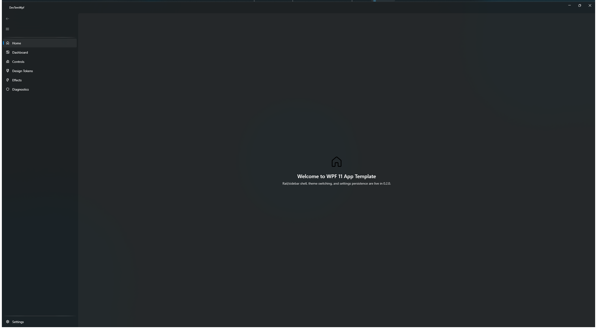
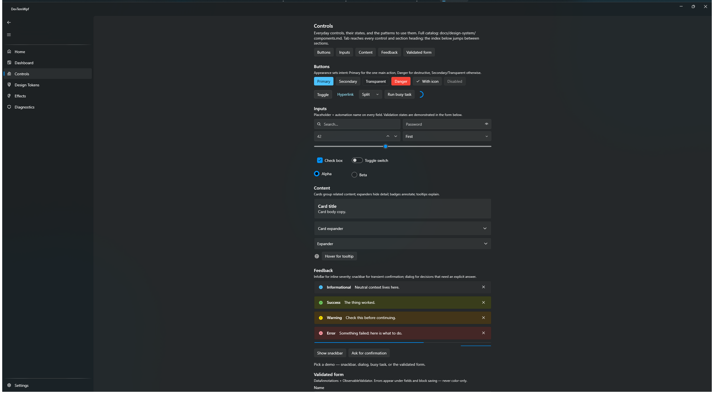
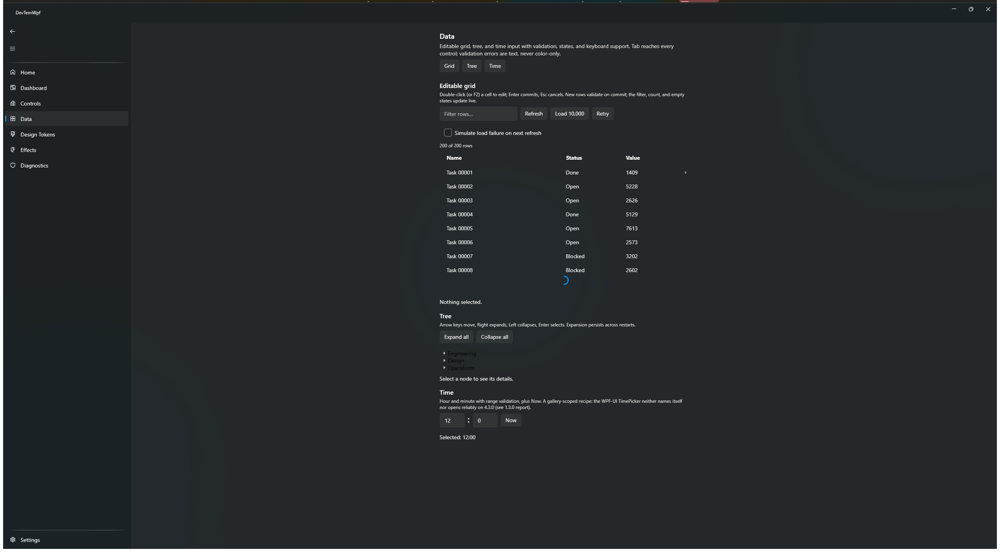
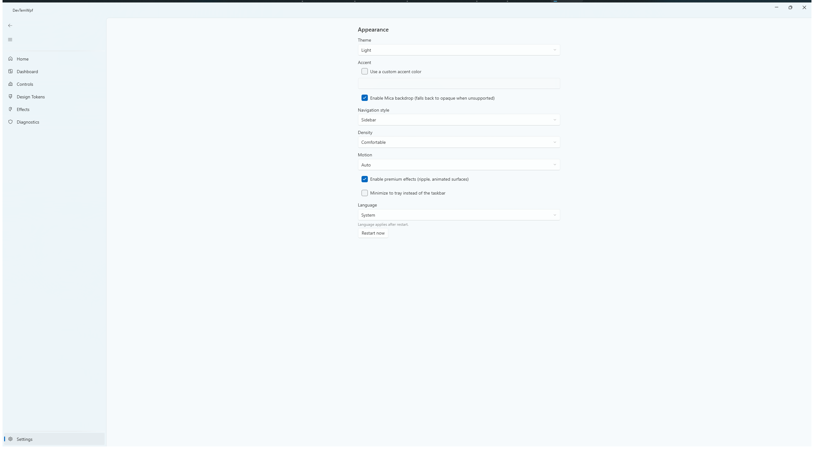
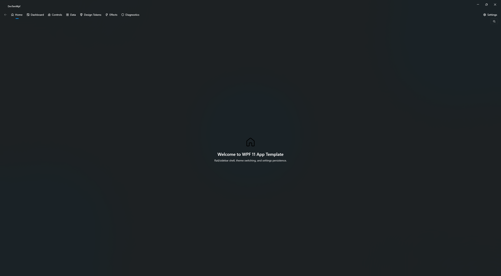
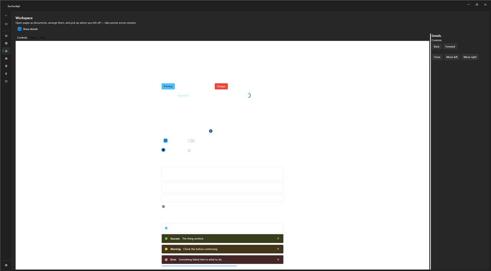
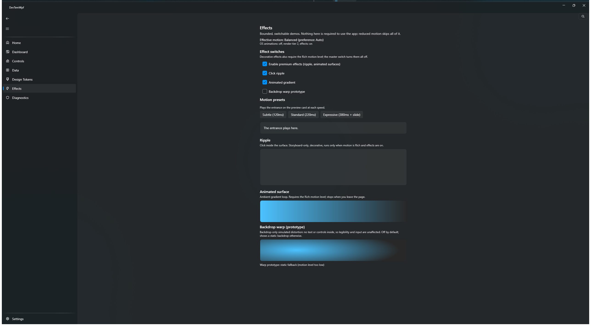
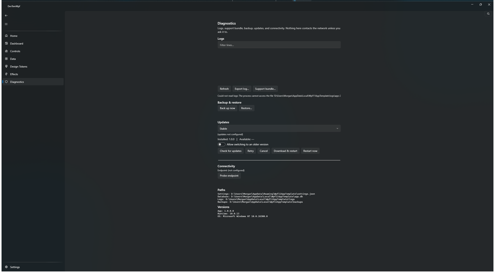

# WPF 11 App Template

[](https://dotnet.microsoft.com/download/dotnet/10.0)
[](https://www.microsoft.com/windows/windows-11)
[](https://github.com/lepoco/wpfui)
[](LICENSE)
[](https://github.com/Fettah010/wpf-11-app-template/releases)

A premium, Windows 11-first **WPF application template** and reusable **UI
foundation** — Fluent design, MVVM, dependency injection, modular production
services, and `dotnet new` scaffolding with clean / recommended / full presets.

> **Status:** `1.6.0` — stable. Per-service template modules, hardened
> updates, optional auth/crash samples, and privacy-bounded logging. Install the
> template, generate your app, and ship it:
> `dotnet new install DevTemWPF.Templates` (see
> [Roadmap](#roadmap--milestones) for what's next).
>
> ```powershell
> dotnet new install <repo>
> dotnet new devtemwpf-app -n MyApp --Preset Full
> ```

## ✨ Highlights

- 🪟 **Windows 11 first** — Fluent visuals, correct window behavior, DPI-aware
  layouts, Mica/acrylic-style materials (opt-in, with opaque fallbacks).
- 🧱 **Reusable UI foundation** — design tokens, shells (rail, sidebar, tabs,
  …), high-quality controls, and a coherent motion system.
- 📦 **Clean / Recommended / Full presets** — start minimal or
  feature-rich; optional modules (logging, SQLite, updates, tray, …) are
  removable, never forced.
- ⚡ **Performance as a feature** — measured baselines, `Auto`/`Balanced`/`Rich`
  effect profiles, reduced-motion and low-power fallbacks.
- 🤖 **Agent-friendly** — predictable structure, ADRs, repeatable CLI
  workflows, verifiable acceptance criteria per milestone.

## 🚀 Quick start

**Prerequisites:** Windows 11 · [.NET 10 SDK](https://dotnet.microsoft.com/download/dotnet/10.0)

```powershell
git clone https://github.com/Fettah010/wpf-11-app-template.git
cd wpf-11-app-template
dotnet restore
dotnet build -c Release
dotnet test -c Release
# full gate: build + tests + app launch check
powershell -ExecutionPolicy Bypass -File eng/smoke.ps1
```

## 🖼️ Screenshots

Reference app (`1.5.0`, Comfortable density, Dark theme unless noted) — Home
shell, Controls gallery with section index, Data gallery, Settings in the
Light theme, the Effects & motion showcase, and the Top + Tabbed navigation
shells:

| Home | Controls gallery |
|---|---|
|  |  |

| Data gallery | Settings (Light) |
|---|---|
|  |  |

| Top navigation shell | Tabbed document workspace |
|---|---|
|  |  |

Effects & motion showcase (`1.5.0`) — the master + per-effect switches
(ripple, gradient, and the off-by-default simulated backdrop-distortion
prototype) and the honest static fallback used under Reduced/Off or a
low-spec/low-tier adapter:



Diagnostics (`1.6.0`) — bounded/redacted logs, support bundle, backup/restore,
and the update surface (installed vs available version, delta/full, retry,
cancel, restart prompt, and an opt-in downgrade switch):



Captured 2026-10-17 on Windows 11 build 26300.9711, 2560×1440 display,
maximized app window, Dark theme unless noted (`gallery-diagnostics.png`
captured 2026-10-18). Recapture gallery pages with
`powershell -ExecutionPolicy Bypass -File eng/capture-screenshots.ps1`; the
shell plates (`shell-top.png`, `shell-tabbed.png`) come from
`eng/verify-shell-surfaces.ps1 -SaveAs`, which captures deterministically and
also asserts the theme-surface invariants. Keep this provenance line accurate.

## 🗺️ Roadmap & milestones

| Version | Focus | Status |
|---|---|---|
| `0.1.0` | Foundation, ADRs, minimal app | ✅ Released |
| `0.2.0` | Window experience, nav rail + sidebar | ✅ Released |
| `0.3.0` | Design tokens & themes | ✅ Released |
| `0.4.0` | Essential controls & forms | ✅ Released |
| `0.5.0` | Motion system & optional effects | ✅ Released |
| `0.6.0` | Layouts, data controls, dashboard & gallery | ✅ Released |
| `0.7.0` | Production services & distribution | ✅ Released |
| `0.8.0` | `dotnet new` scaffolding & generators | ✅ Released |
| `0.9.0` | Beta hardening | ✅ Released |
| `1.0.0-rc.1` | API freeze & candidate validation | ✅ Released |
| `1.0.0` | Stable template and UI foundation | ✅ Released |
| `1.1.0` | Stabilization and test truth | ✅ Released |
| `1.2.0` | Visual-system upgrade | ✅ Released |
| `1.3.0` | Core control and data completion | ✅ Released |
| `1.4.0` | Navigation shells & Tabbed document workspace | ✅ Released |
| `1.4.1` | Tabbed shell themed-surface fix | ✅ Released |
| `1.5.0` | Advanced motion system & effects prototype | ✅ Released |
| `1.6.0` | Per-service modules, updates/backup hardening, optional auth/crash | ✅ Released |

Full product plan: [`WPF-11-App-Template-Roadmap-1.0-to-2.0.md`](WPF-11-App-Template-Roadmap-1.0-to-2.0.md) ·
per-version plans/reports: [`docs/releases/`](docs/releases/) ·
decisions: [`docs/decisions/`](docs/decisions/).

## 🛠️ Tech stack

| Concern | Choice |
|---|---|
| UI toolkit | [WPF-UI 4.3.0](https://github.com/lepoco/wpfui) (MIT) |
| MVVM | [CommunityToolkit.Mvvm 8.4.2](https://github.com/CommunityToolkit/dotnet) |
| DI / hosting | Microsoft.Extensions.Hosting 10.0.12 |
| Tests | xUnit.net v3 (Microsoft Testing Platform mode) |
| Updates / distribution | Velopack + MSIX paths (from `0.7.0`) |

Dependency inventory & licenses: [`docs/DEPENDENCIES.md`](docs/DEPENDENCIES.md)
· [`NOTICE-THIRD-PARTY.md`](NOTICE-THIRD-PARTY.md).

## 📁 Project structure

```text
src/DevTemWpf.App/   # reference app (embryo of the clean preset)
tests/               # unit + integration (xUnit v3, MTP mode)
docs/                # decisions, guides, per-release plans/reports
eng/                 # smoke/UI/perf gates (smoke, check-ui-tests,
                     # measure-startup, measure-motion, …)
```

Conventions: central package management, pinned SDK (`global.json`),
analyzers + formatting enforced, zero-warning builds.

## 🤝 Contributing

Issues and PRs are welcome. Please keep the current milestone's scope
(`docs/releases/`), add tests with behavior changes, and update docs in the
same change. See `WPF-AGENT-EXECUTION-PROTOCOL.md` for the working contract.

## 📄 License

MIT — see [LICENSE](LICENSE). Third-party notices:
[NOTICE-THIRD-PARTY.md](NOTICE-THIRD-PARTY.md).
