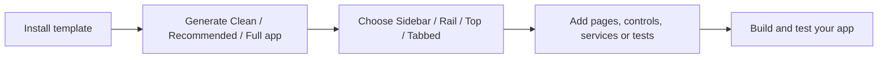
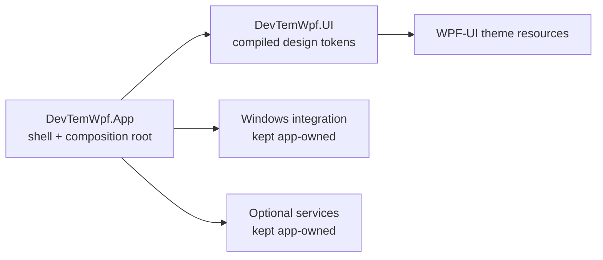

# WPF 11 App Template

[](https://dotnet.microsoft.com/download/dotnet/10.0)
[](https://www.microsoft.com/windows/windows-11)
[](https://github.com/lepoco/wpfui)
[](LICENSE)
[](https://github.com/Fettah010/wpf-11-app-template/releases)

A premium, Windows 11-first **WPF application template** and reusable **UI
foundation** — Fluent design, MVVM, dependency injection, modular production
services, and `dotnet new` scaffolding with clean / recommended / full presets.

> **Current stable:** `1.6.0`. The `1.7.0` scaffolding release is awaiting
> final merge and publication; it is not a stable install target yet. The
> `1.8.0` architecture work is a prototype, not a released package contract.
> To start from the current stable template:
> `dotnet new install DevTemWPF.Templates` (see
> [Release notes](https://github.com/Fettah010/wpf-11-app-template/releases)
> and the [canonical roadmap](WPF-11-App-Template-Roadmap-1.0-to-2.0.md)).
>
> ```powershell
> dotnet new install <repo>
> dotnet new devtemwpf-app -n MyApp --Preset Full
> cd src/MyApp.App
> dotnet new devtemwpf-datagrid -n OrdersPage --RootNamespace MyApp
> ```

## ✨ Highlights

- 🪟 **Windows 11 first** — Fluent visuals, correct window behavior, DPI-aware
  layouts, Mica/acrylic-style materials (opt-in, with opaque fallbacks).
- 🧱 **Reusable UI foundation** — design tokens, shells (rail, sidebar, tabs,
  …), high-quality controls, and a coherent motion system.
- 📦 **Clean / Recommended / Full presets** — start minimal or
  feature-rich; optional modules (logging, SQLite, updates, tray, …) are
  removable, never forced.
- ⚡ **Performance as a feature** — measured baselines, `Auto`/`Balanced`/`Rich`
  effect profiles, reduced-motion and low-power fallbacks.
- 🤖 **Agent-friendly** — predictable structure, ADRs, repeatable CLI
  workflows, verifiable acceptance criteria per milestone.
- 🧩 **Generators for the boring parts** — eleven `dotnet new` item templates
  (page, settings, list-detail, DataGrid, TreeView, tab document, custom
  control, ViewModel, service, and behavioral test scaffolds) that emit code
  in project conventions and compile as generated.

## 🚀 Quick start

**Prerequisites:** Windows 11 · [.NET 10 SDK](https://dotnet.microsoft.com/download/dotnet/10.0)

```powershell
git clone https://github.com/Fettah010/wpf-11-app-template.git
cd wpf-11-app-template
dotnet new install .
dotnet new devtemwpf-app -n Orders --Preset Recommended --Shell Tabbed
cd Orders
dotnet new devtemwpf-datagrid -n OrdersPage -o .\src\Orders.App --RootNamespace Orders
dotnet build .\Orders.slnx -c Release
```

Prefer the published template package? Install the `.nupkg` attached to the
desired GitHub release instead of cloning the repository:

```powershell
dotnet new install .\DevTemWPF.Templates.<version>.nupkg
dotnet new devtemwpf-app -n MyApp --Preset Clean
```

### The workflow



Templates are generators, not a runtime dependency: generated projects own
their source and can be customized normally.

### Choose a starting point

- **Clean** — minimal application foundation and test project; no gallery
  dashboard or optional production modules.
- **Recommended** — practical starter services and diagnostics for a typical
  desktop app.
- **Full** — reference gallery, dashboard, charts and broader examples.

`Custom` lets you choose modules individually. Every shell is available in
each generated app; `--Shell` selects the first-launch default. See the
[preset and module guide](docs/template/module-selection.md) before choosing
optional packages.

## 🖼️ Screenshots

Reference app (`1.5.0`, Comfortable density, Dark theme unless noted) — Home
shell, Controls gallery with section index, Data gallery, Settings in the
Light theme, the Effects & motion showcase, and the Top + Tabbed navigation
shells:

| Home | Controls gallery |
|---|---|
|  |  |

| Data gallery | Settings (Light) |
|---|---|
|  |  |

| Top navigation shell | Tabbed document workspace |
|---|---|
|  |  |

Effects & motion showcase (`1.5.0`) — the master + per-effect switches
(ripple, gradient, and the off-by-default simulated backdrop-distortion
prototype) and the honest static fallback used under Reduced/Off or a
low-spec/low-tier adapter:


Diagnostics (`1.6.0`) — bounded/redacted logs, support bundle, backup/restore,
and the update surface (installed vs available version, delta/full, retry,
cancel, restart prompt, and an opt-in downgrade switch):


Captured 2026-10-17 on Windows 11 build 26300.9711, 2560×1440 display,
maximized app window, Dark theme unless noted (`gallery-diagnostics.png`
captured 2026-10-18). Recapture gallery pages with
`powershell -ExecutionPolicy Bypass -File eng/capture-screenshots.ps1`; the
shell plates (`shell-top.png`, `shell-tabbed.png`) come from
`eng/verify-shell-surfaces.ps1 -SaveAs`, which captures deterministically and
also asserts the theme-surface invariants. Keep this provenance line accurate.

## 🧭 Project direction

The template is evolving from a polished reference app into a modular,
independently consumable WPF foundation. The current work is focused on
reliable scaffolding, package-boundary evidence and a tested 1.x-to-2.0
upgrade path—not on breaking the stable 1.x template.

For authoritative scope and sequencing, see the
[product roadmap](WPF-11-App-Template-Roadmap-1.0-to-2.0.md). The current
[1.8.0 plan](docs/releases/1.8.0-plan.md) and
[migration draft](docs/releases/1.8.0-migration.md) document the package-boundary
proof; [ADR-0020](docs/decisions/ADR-0020-ui-resource-package-boundary.md)
records why only the token-resource library is accepted. Per-release evidence
lives in [`docs/releases/`](docs/releases/), architectural decisions in
[`docs/decisions/`](docs/decisions/), and delivered changes in the
[`changelog`](CHANGELOG.md).



> **Prototype notice:** `src/DevTemWpf.UI` is an isolated 1.8.0 experiment
> for compiled design-token resources. It is not part of the stable template
> package and should not be treated as a supported public API.

## 🛠️ Tech stack

| Concern | Choice |
|---|---|
| UI toolkit | [WPF-UI 4.3.0](https://github.com/lepoco/wpfui) (MIT) |
| MVVM | [CommunityToolkit.Mvvm 8.4.2](https://github.com/CommunityToolkit/dotnet) |
| DI / hosting | Microsoft.Extensions.Hosting 10.0.12 |
| Tests | xUnit.net v3 (Microsoft Testing Platform mode) |
| Updates / distribution | Velopack + MSIX paths (from `0.7.0`) |

Dependency inventory & licenses: [`docs/DEPENDENCIES.md`](docs/DEPENDENCIES.md)
· [`NOTICE-THIRD-PARTY.md`](NOTICE-THIRD-PARTY.md).

## 📁 Project structure

```text
src/DevTemWpf.App/   # reference app and gallery
src/DevTemWpf.UI/    # isolated 1.8.0 token-resource package prototype
tests/               # unit + integration (xUnit v3, MTP mode)
templates/items/     # eleven dotnet new item templates (docs/template/item-templates.md)
docs/                # decisions, guides, per-release plans/reports
eng/                 # smoke/UI/perf/generator gates (smoke, check-ui-tests,
                     # test-generators, measure-startup, measure-motion, …)
```

Conventions: central package management, pinned SDK (`global.json`),
analyzers + formatting enforced, zero-warning builds. UI automation requires
an interactive Windows desktop; the required gate fails rather than counting
skipped tests as passes.

## 🤝 Contributing

Issues and PRs are welcome. Please keep the current milestone's scope
(`docs/releases/`), add tests with behavior changes, and update docs in the
same change. See `WPF-AGENT-EXECUTION-PROTOCOL.md` for the working contract.

## 📄 License

MIT — see [LICENSE](LICENSE). Third-party notices:
[NOTICE-THIRD-PARTY.md](NOTICE-THIRD-PARTY.md).
