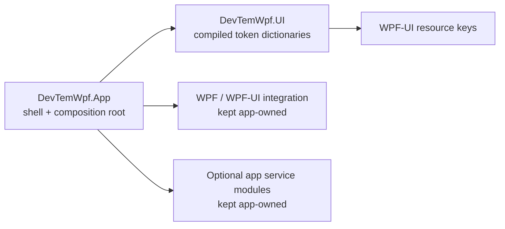

# ADR-0020: UI resource package boundary

- Status: Accepted for the 1.8.0 architecture proof
- Date: 2026-10-28
- Milestone: 1.8.0 (§8.8)
- Supersedes: none; narrows ADR-0003 only for compiled design-token resources

## Context

The 2.0 roadmap calls for independently consumable UI/Windows/App/Services
assemblies, but ADR-0003 rejects speculative projects without a real consumer.
The app's five compiled design-token dictionaries are consumed by its views,
and the app also owns shell chrome, motion, Windows integration, and optional
service modules. The 1.8 prototype moved only the token dictionaries into
`DevTemWpf.UI`; it did not move controls, application services, or the shell.

## Options

1. Keep all code in the app and defer every split.
2. Split UI, Windows, and services into separate packages now.
3. Accept the tested UI-resource boundary only; retain Windows and services in
   the app until each has an independent consumer.

## Decision

Choose option 3. `DevTemWpf.UI` owns the compiled `DesignTokens/` resource
dictionaries. `DevTemWpf.App` remains the composition root and owns
`App.xaml`, shell/navigation, density selection, motion, Windows integration,
and service registrations/implementations. Windows and service assemblies
are explicitly deferred; no empty or speculative projects are created.

The current UI package is an architecture proof, not a stable public control
API. It exposes token dictionaries and resource keys only. Revisit package
identity and API stability during the 2.0 preview before making a stable
package compatibility promise.

## Dependency diagram

The `Windows` and `Services` nodes describe app-owned responsibilities, not
new assemblies.

## Evidence and validation

- The independent consumer in `experiments/1.8.0/ui-package-consumer/` restores
  the packed `DevTemWpf.UI` package and has no project reference to the app or
  gallery.
- `eng/test-ui-package.ps1` packs the library, builds the clean consumer with
  warnings as errors, checks the Comfortable (`AppPageMargin = 24`) and Compact
  (`AppPageMargin = 16`) resources including runtime dictionary replacement,
  and launches the consumer.
- App integration tests resolve the referenced-assembly pack URIs and verify
  density switching.
- The template's optional-module flags already remove optional source,
  references, registrations, configuration, and tests. No second consumer
  demonstrates an additional service-package boundary.
- `MainWindow`, `MotionService`, backdrop, tray, and notification behavior
  depend on app shell/settings/WPF-UI contracts and have no independent
  consumer. Moving them now would add coupling or duplicate composition
  without proving reuse.
- Pack URI reference: [WPF pack URIs](https://learn.microsoft.com/en-us/dotnet/desktop/wpf/app-development/pack-uris-in-wpf)
  (accessed 2026-10-28).

## Consequences

- The generated app includes the UI resource project and references it; the
  package-only canary verifies downstream package consumption independently.
- Resource merge order remains in the app: WPF-UI themes/controls first, then
  the token dictionaries. Density selection remains app-owned.
- Windows/service splits remain no-go until there is an actual independent
  consumer, a documented dependency boundary, and a passing canary for that
  package.
- No custom controls, `Themes/Generic.xaml`, or new runtime dependencies are
  added by this decision.

## Revisit triggers

- A second independent consumer needs the UI resources or a stable UI API.
- A second consumer demonstrates a specific Windows or service package
  boundary that removes duplication without coupling to the gallery.
- Clean-machine framework targeting or package-restore evidence changes the
  supported target framework.
